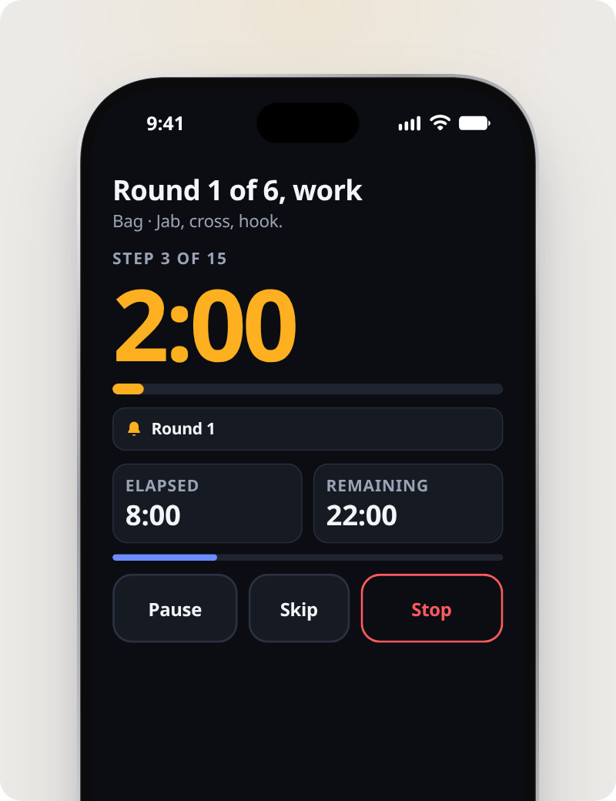
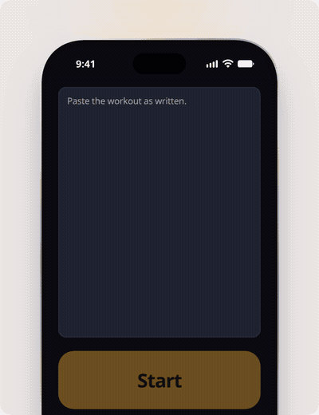

# Interval Chime

  

  

A tiny, dependency-free interval timer for workouts. It's an installable PWA (works offline, no tracking). Paste a workout, tap Start, and each step chimes and is spoken. The loop above is a 12 second faux UI of that, built with [Stageshow](https://github.com/benjitaylor/skills/tree/main/stageshow). A looping MP4 is at [`promo/demo.mp4`](promo/demo.mp4), and the same demo plays at [`/promo/`](https://alexaweau.github.io/interval-chime/promo/).

The main screen is one three-column wheel: work, rest, and total time. Defaults are 1:00 work, 0:30 rest, and 15:00 total (10 rounds). Changing either interval snaps the total to the nearest whole number of rounds — near 15 minutes until the total has been set, then near the total you set. The total column only lists whole rounds.

Below the fold: the old interval and session presets, custom lengths, lead-in beeps, silent-switch audio, volume, and a test chime.

- A bell at the end of each work interval and each rest interval, and a distinct triple chime when the session ends.
- The run screen is the current step, a large countdown, and the next step (name, cue, and round). Pause and Stop stay at the bottom of the screen. Tap Stop twice to confirm.
- Timing is computed from `performance.now()` (with a wall-clock correction after device sleep). Chimes are pre-scheduled on the Web Audio clock up to 10 minutes ahead.
- Screen Wake Lock while running, re-acquired when the app becomes visible again.
- Settings are saved in localStorage.

## Files
`index.html`, `styles.css`, `app.js`, `sw.js`, `manifest.webmanifest`, `icons/` hold the whole app. No build step. `promo/` is a separate Stageshow page with its own build; the service worker does not cache it.
`tools/` has the icon generator, the headless test (`python3 tools/test_app.py http://127.0.0.1:8765/`) and the deploy script.
`?test=1` adds 2 s / 5 s work presets, 1-second wheel steps through 1:30, and 10 to 30 s sessions for quick testing.

## iPhone notes
- **Silent switch:** with "Ring with silent switch on" enabled (default), Start sets `navigator.audioSession.type = 'playback'`
  (Safari 17+) and loops a near-silent audio clip. This puts iOS into its media-playback audio mode, so Web Audio ignores the ringer
  switch. Side effect: iOS treats the app like a music player, so it **pauses music or podcasts from other apps**. Turn the
  option off to mix with your music; chimes then follow the silent switch.
